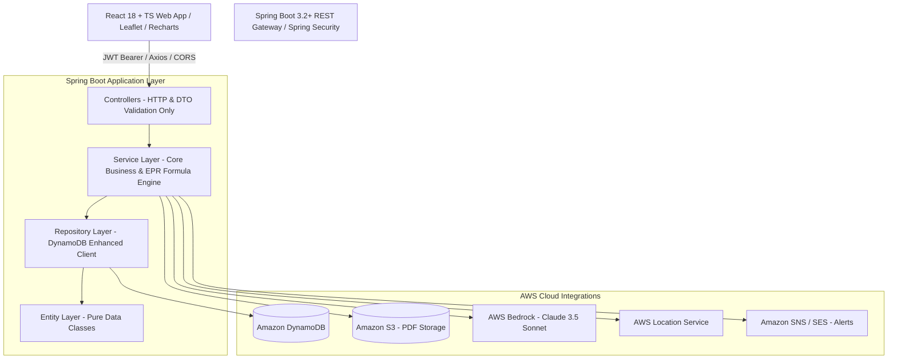

# EPR Compliance Tracker — Comprehensive Implementation Plan
**Document Version:** 1.0  
**Target:** Production-Grade Full-Stack Compliance Platform ("ClearTax for e-waste")  
**Regulatory Framework:** India's E-Waste (Management) Rules, 2022 (Central Pollution Control Board - CPCB)

---

## 1. System Architecture Overview

---

## 2. Strict Engineering Guardrails

1. **Architecture & Layers:** `Controller -> Service -> Repository -> Entity`. No skipping, no direct repository access from controllers, no business logic in controllers or entities.
2. **Dependency Injection:** Constructor injection everywhere (Lombok `@RequiredArgsConstructor` or explicit constructor). Zero `@Autowired` field injection.
3. **Data Protection:** Never return `@Entity` in API responses; all endpoints strictly accept and return typed `DTO` records/classes.
4. **Resilience & Exceptions:** All controller exceptions intercepted by `@RestControllerAdvice GlobalExceptionHandler`. AWS exceptions mapped to user-friendly `503` without leaking credentials or raw stack traces.
5. **Formatting & Locales:** Indian number system formatting across UI and reports (`10,00,000` instead of `1,000,000`).
6. **Frontend Rigor:** Zero TypeScript `any` types. Skeleton loading states for all async views. In-memory JWT token persistence (never raw `localStorage`). Handcrafted Tailwind components matching design system tokens.

---

## 3. Mathematical & Regulatory Model (CPCB Rules 2022)

### EPR Obligation Formula
$$Q_{EPR} = Q_p \times C_f \times \text{Target \%}$$
Where:
- $Q_p$ = Quantity/Units sold in target market
- $C_f = \frac{1}{\text{Average product lifespan in years}}$
- $\text{Target \%}$ schedule:
  - FY2023-24: 60%
  - FY2024-25: 65%
  - FY2025-26: 70%
  - **FY2026-27: 80%**
  - FY2027-28: 90%

### Lifespan & Conversion Factor ($C_f$) Catalog (20 Product Categories)
| Category Enum | Lifespan | $C_f$ | Category Enum | Lifespan | $C_f$ |
|---|---|---|---|---|---|
| `MOBILE_PHONE` | 3 yrs | 0.333 | `LAPTOP_COMPUTER` | 5 yrs | 0.200 |
| `TELEVISION` | 7 yrs | 0.143 | `AIR_CONDITIONER` | 10 yrs | 0.100 |
| `EARPHONE_HEADPHONE` | 3 yrs | 0.333 | `WASHING_MACHINE` | 10 yrs | 0.100 |
| `REFRIGERATOR` | 12 yrs | 0.083 | `PRINTER_SCANNER` | 5 yrs | 0.200 |
| `TABLET` | 4 yrs | 0.250 | `CAMERA` | 5 yrs | 0.200 |
| `MICROWAVE_OVEN` | 8 yrs | 0.125 | `WATER_PURIFIER` | 7 yrs | 0.143 |
| `UPS_INVERTER` | 6 yrs | 0.167 | `COMPUTER_MONITOR` | 6 yrs | 0.167 |
| `HARD_DISK_SSD` | 4 yrs | 0.250 | `ROUTER_MODEM` | 5 yrs | 0.200 |
| `SMARTWATCH_WEARABLE` | 3 yrs | 0.333 | `EV_CHARGER` | 10 yrs | 0.100 |
| `SOLAR_PANEL_INVERTER` | 15 yrs | 0.067 | `OTHER_EEE` | 5 yrs | 0.200 |

---

## 4. DynamoDB Schema & Access Patterns

### 1. `epr-tracker-companies`
- **PK:** `companyId` (UUID)
- **GSI:** `email-index` (`email` as partition key)
- **Attributes:** `companyName`, `email`, `passwordHash`, `state`, `cpcbRegistrationNumber`, `registeredOn`, `alertsEnabled`, `alertEmail`, `alertPhone`

### 2. `epr-tracker-products`
- **PK:** `productId` (UUID)
- **SK:** `companyId` (String)
- **Attributes:** `productName`, `productCategory`, `unitsSold`, `conversionFactor`, `financialYear`, `eprObligationUnits`, `createdAt`

### 3. `epr-tracker-compliance-log`
- **PK:** `logId` (UUID)
- **SK:** `companyId` (String)
- **Attributes:** `recyclerId`, `recyclerName`, `quantityCollectedKg`, `eprCertificateNumber`, `dateLogged`, `financialYear`

### 4. `epr-tracker-recyclers`
- **PK:** `recyclerId` (UUID)
- **GSI:** `state-index` (`state` as partition key)
- **Attributes:** `name`, `state`, `city`, `latitude`, `longitude`, `categoriesHandled` (List), `cpcbCertified`, `contactEmail`, `contactPhone`, `capacityTonnesPerYear`

---

## 5. Phased Implementation Roadmap

```mermaid
gantt
    title EPR Compliance Tracker Development Phases
    dateFormat  X
    axisFormat  Day %d
    section Phase 1: Backend Foundation
    POM & Config & AWS Clients       :active, p1_1, 0, 1
    DynamoDB Schema & Repositories   :p1_2, 1, 2
    Seed Data Loader (30 Recyclers) :p1_3, 2, 3
    JWT Authentication Flow          :p1_4, 3, 4
    section Phase 2: Core Domain Logic
    EPR Calculator Service & Tests   :p2_1, 4, 5
    Compliance Log & Aggregations    :p2_2, 5, 6
    Recycler Search & Proximity      :p2_3, 6, 7
    section Phase 3: Cloud & AI Services
    iText 7 PDF & S3 Presigned URLs  :p3_1, 7, 8
    AWS Bedrock Claude Sonnet Chat   :p3_2, 8, 9
    SNS & Alert Scheduling           :p3_3, 9, 10
    section Phase 4: Frontend Development
    Vite + TS + Tailwind Scaffold    :p4_1, 10, 11
    Auth, Context & Protected Routes :p4_2, 11, 12
    Dashboard & Recharts Integration :p4_3, 12, 13
    EPR Calculator & Product CRUD    :p4_4, 13, 14
    Leaflet Map Recycler Finder      :p4_5, 14, 15
    Compliance Logs & CSV Export     :p4_6, 15, 16
    AI Assistant Drawer & Settings   :p4_7, 16, 17
    section Phase 5: Verification & Polish
    Skeleton States & Indian Formats :p5_1, 17, 18
    End-to-End Validation (375px/1440px):p5_2, 18, 19
```

### Detailed Phase Breakdown

#### Phase 1: Spring Boot Infrastructure & Authentication
- **Step 1.1:** Maven `pom.xml` configuration with AWS SDK v2, Spring Security, JJWT, iText, MapStruct, and Lombok.
- **Step 1.2:** Configuration files (`application.yml`, `AwsConfig.java`, `CorsConfig.java`, `SecurityConfig.java`).
- **Step 1.3:** DynamoDB entity mappings using AWS SDK v2 Enhanced Client (`Company`, `Product`, `ComplianceLog`, `Recycler`).
- **Step 1.4:** Generic DynamoDB repository adapters and database auto-initialization.
- **Step 1.5:** Startup `CommandLineRunner` to seed 5 demo companies and 30 CPCB-certified recyclers across 10 Indian cities.
- **Step 1.6:** JWT authentication (`JwtTokenProvider`, `JwtAuthFilter`, `AuthService`, `AuthController`).

#### Phase 2: Core EPR Compliance & Recycler Domain
- **Step 2.1:** `EprConstants.java` implementing the 20 CPCB categories and target percentage matrix.
- **Step 2.2:** `EprCalculatorService` implementing the exact formula and financial year resolution.
- **Step 2.3:** Product lifecycle management (`ProductService`, `ProductController`, DTOs, validations).
- **Step 2.4:** Compliance logging engine with cumulative metrics calculation (`ComplianceLogService`, `ComplianceLogController`).
- **Step 2.5:** Recycler directory & geo-filtering (`RecyclerService`, `RecyclerController`).

#### Phase 3: Reports, AWS Bedrock & Alert Notifications
- **Step 3.1:** `ReportService` utilizing iText to assemble 7-section compliance documents matching CPCB filing guidelines.
- **Step 3.2:** `S3Service` for secure PDF storage and generating 24-hour presigned download URLs.
- **Step 3.3:** `AiAssistantService` integrating AWS Bedrock Claude 3.5 Sonnet with the compliance system prompt.
- **Step 3.4:** `AlertService` integrating SNS for threshold alerts (90 days, 30 days, quarterly filings).

#### Phase 4: React 18 + TypeScript Client Application
- **Step 4.1:** Scaffold React + Vite + Tailwind CSS project without third-party component libraries.
- **Step 4.2:** Custom Design System adhering to color palette tokens (`#0D1117`, `#161B22`, `#3FB950`, `#D29922`, `#F85149`, etc.) and Google Fonts (IBM Plex Sans / IBM Plex Mono).
- **Step 4.3:** AuthContext managing in-memory JWT tokens and Axios interceptor pipeline.
- **Step 4.4:** Handcrafted UI primitives: `Button`, `Input`, `Badge`, `Skeleton`, `Modal`, `Toast`, `Drawer`.
- **Step 4.5:** 9 Application Pages:
  1. Auth (Login & Registration)
  2. Dashboard (4 KPI cards, compliance status badge, Recharts trend graph, quick actions)
  3. EPR Calculator (category selectors, immediate obligation preview, products table)
  4. Recycler Finder (Leaflet.js interactive map + category/state filters)
  5. Compliance Log (collection logger, cumulative badge, CSV exporter)
  6. AI Assistant (floating drawer with quick prompts and streaming support)
  7. Reports (generate button, polling/status indicator, history with presigned links)
  8. Alert Settings (SMS/Email toggles, frequency monitors)
  9. Company Profile (CPCB reg number edit, password update, safety deletion)

#### Phase 5: Verification, Testing & Mobile Polishing
- **Step 5.1:** Responsive design verification at 375px (mobile tab navigation) and 1440px desktop layouts.
- **Step 5.2:** Skeleton loaders for all network interactions; zero spinner usage.
- **Step 5.3:** Verification of Indian number formatting (`10,00,000`) across all cards, tables, and charts.
- **Step 5.4:** End-to-end user journey test: Register -> Add Product -> Calculate -> Find Recycler -> Log Compliance -> Download PDF -> Consult AI.

---

## 6. Execution Decision Gate

To maintain compliance with the project build order:
- We begin by materializing **STEP 1** files (`backend/pom.xml`, `application.yml`, `AwsConfig.java`, and `GlobalExceptionHandler.java`).
- Once verified, we proceed sequentially through each build milestone.
