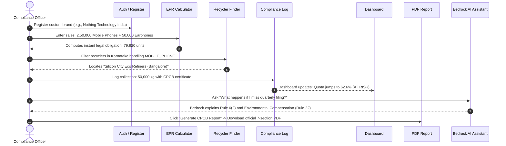

# Real-Data Testing Guide: EPR Compliance Tracker
**Regulatory Framework:** India's E-Waste (Management) Rules, 2022 (CPCB)  
**System URL:** [http://localhost:3000](http://localhost:3000)

---

## 1. Quick Test Personas (Pre-Seeded Real Industry Brands)

You can test immediately with pre-calculated real industry portfolios:

| Persona | Brand | Products & Sales Volume | Status & Expected Numbers |
|---|---|---|---|
| **Audio & Wearables** | **boAt Lifestyle** (`compliance@boat-lifestyle.com` / `password123`) | • 10,00,000 Earphones ($C_f = 0.333$) • 5,00,000 Feature Phones ($C_f = 0.333$) | **AT RISK (~50.1%)** Obligation: **3,99,600 units** Collected: **2,00,000 kg** Outstanding: **1,99,600 units** |
| **Smartphones & Tablets** | **Vivo India** (`compliance@vivo.com` / `password123`) | • 8,00,000 5G Phones ($C_f = 0.333$) • 2,00,000 Tablets ($C_f = 0.250$) | **ON TRACK (~83%)** Obligation: **2,53,120 units** Collected: **2,10,000 kg** |
| **HVAC & Cooling** | **Blue Star Limited** (`compliance@bluestarindia.com` / `password123`) | • 3,00,000 Inverter ACs ($C_f = 0.100$) | **NON-COMPLIANT (~20.8%)** Obligation: **24,000 units** Collected: **5,000 kg** |
| **Enterprise IT** | **Dell India** (`compliance@dell.com` / `password123`) | • 4,00,000 Laptops ($C_f = 0.200$) • 1,00,000 Printers ($C_f = 0.200$) | **ON TRACK (~81.2%)** Obligation: **80,000 units** Collected: **65,000 kg** |
| **Major Appliances** | **Whirlpool India** (`compliance@whirlpool.com` / `password123`) | • 2,50,000 Washing Machines ($C_f = 0.100$) • 1,50,000 Refrigerators ($C_f = 0.083$) | **AT RISK (~46.7%)** Obligation: **29,960 units** Collected: **14,000 kg** |

---

## 2. Step-by-Step End-to-End Real Testing Workflow

Follow this 6-step test scenario to verify all features with your own custom data:

---

### Step A: Register Your Own Enterprise Brand
1. Open [http://localhost:3000](http://localhost:3000) and click **"Register Brand"**.
2. Input real corporate registration details:
   - **Company Name:** `Nothing Technology India Pvt Ltd`
   - **State / UT:** `Karnataka`
   - **CPCB Registration Number:** `CPCB/EPR/NOTH/2024/098`
   - **Official Business Email:** `compliance@nothing.tech`
   - **Password:** `password123`
3. Click **"Create Enterprise Account"**.
4. You will be authenticated with a JWT token and taken to an empty Dashboard.

---

### Step B: Input Sales Volume in the EPR Calculator
1. Click **"EPR Calculator"** in the sidebar.
2. Select Financial Year: **FY2026-27 (80% Target)**.
3. Add Product 1:
   - **Product Name:** `Nothing Phone (2a)`
   - **CPCB Category:** `Mobile Phones (3 yrs, Cf: 0.333)`
   - **Units Sold:** `250000`
   - Notice the **Instant Legal Preview card** calculates in real time:
     $$2,50,000 \times 0.333 \times 0.80 = \mathbf{66,600\text{ units obligation}}$$
   - Click **"+ Add to EPR Inventory"**.
4. Add Product 2:
   - **Product Name:** `Nothing Ear (a) Audio`
   - **CPCB Category:** `Earphones & Headphones (3 yrs, Cf: 0.333)`
   - **Units Sold:** `50000`
   - Real-time preview:
     $$50,000 \times 0.333 \times 0.80 = \mathbf{13,320\text{ units obligation}}$$
   - Click **"+ Add to EPR Inventory"**.
5. Check the **Portfolio Cumulative Total** card at the bottom:
   - Total sales: `3,00,000 units`
   - Total obligation: `79,920 units to recycle`

---

### Step C: Discover Authorized Recyclers Across India
1. Click **"Recycler Finder"** in the sidebar.
2. **Interactive Map View:** Observe Leaflet map pins across 10 major Indian industrial hubs (Delhi, Mumbai, Bengaluru, Chennai, Hyderabad, Pune, Kolkata, Ahmedabad, Jaipur, Lucknow).
3. Filter by **State:** Select `Karnataka`.
4. Filter by **Category:** Select `Mobile Phones`.
5. Click on the Bengaluru pin:
   - **Facility:** `Bengaluru Green E-Waste Recovery`
   - **Annual Capacity:** `4,800 T/yr`
   - **Verification:** `CPCB Certified` badge
   - **Contact Phone:** `+91 80 4112 3344`
6. Switch to **"List View"** to review contact emails and capacities.

---

### Step D: Record a Recycling Certificate in Compliance Log
1. Click **"Compliance Log"** in the sidebar.
2. Under **"Record New Recycled E-Waste Certificate"**:
   - **Select CPCB Recycler:** `Bengaluru Green E-Waste Recovery (Bangalore)`
   - **Quantity Collected (kg):** `50000`
   - **EPR Certificate No.:** `CPCB/REC/KA/2026/8912`
   - **Date Logged:** Today's date
3. Click **"+ Record Certificate"**.
4. Observe the ledger table update and check the **Total Verified Recycling** counter show:
   $$\mathbf{50,000\text{ kg}}$$
5. Click **"📥 Export CSV"** to download the `cpcb-compliance-logs.csv` spreadsheet.

---

### Step E: Review Analytics on the Dashboard
1. Click **"Dashboard"** in the sidebar:
   - **Total EPR Obligation:** `79,920 units`
   - **Collected So Far:** `50,000 kg / units` (Progress bar: `62.6%`)
   - **Outstanding Target:** `29,920 units`
   - **Days to Year-End:** `~171 days` (until March 31, 2027)
   - **Status Badge:** **AT RISK** (between 40% and 70% threshold)
   - **Bar Chart:** Visualizes monthly collection trajectory against targets.

---

### Step F: Generate & Download Official CPCB PDF Report
1. Click **"Reports (iText)"** in the sidebar.
2. Select `FY 2026-27` and click **"⚡ Generate CPCB Report"**.
3. The iText engine compiles the 7 compliance sections and generates a signed Amazon S3 URL.
4. Click **"Download PDF ↗"** to view the document:
   - **Header:** EPR Compliance Tracker / CPCB Compliance Report
   - **Company Details:** Nothing Technology India Pvt Ltd & CPCB number
   - **Executive Summary Table:** Obligation (79,920), Collected (50,000), Outstanding (29,920), Status (AT RISK - 62.6%)
   - **Products Table:** Itemized phones and earphones with $C_f$ factors
   - **Collections Table:** Certificate `CPCB/REC/KA/2026/8912` and recycler name
   - **Status Badge:** `AT RISK` in amber
   - **Footer:** Portal submission URL (`eprewaste.cpcb.gov.in`)

---

### Step G: Test the AI Compliance Assistant (AWS Bedrock)
1. Click the floating purple **"⚡ Ask EPR AI"** button in the bottom right corner.
2. Test one of the suggested prompts:
   - *"What is my EPR obligation for 5 lakh phones?"*
   - *"What happens if I miss the quarterly filing?"*
   - *"Which recyclers are CPCB-certified in Maharashtra?"*
3. Or type a custom regulatory query:
   - *"What are the penalties under Rule 22 for shortfall in e-waste target?"*
4. The assistant will respond with specific rule citations and Indian numeral formatting (`10,00,000`).

---

### Step H: Test Mobile Responsiveness (375px)
1. Open Developer Tools in your browser (`Cmd + Option + I` on macOS or `F12`).
2. Switch device toolbar to **iPhone SE** or set viewport width to **375px**.
157:    - The desktop sidebar collapses.
158:    - The **Mobile Bottom Tab Bar** (`Dashboard`, `Calc`, `Recyclers`, `Logs`, `Reports`) appears.
159:    - All forms, stat cards, and tables reflow smoothly without horizontal layout breakage.

---

## 5. Testing the 5 Enterprise Differentiators

### 1. The "What-If" Environmental Compensation (EC) Simulator (`/ec-simulator`)
1. Go to **EC Penalty Simulator** in the sidebar.
2. Adjust the sliders:
   - **Projected Deficit:** e.g., `50 MT`
   - **Delay Past Deadline:** e.g., `2 Months`
   - **Hazardous Severity Factor:** e.g., `1.2x (Mixed E-Waste)`
3. **CFO Value Justification Result:**
   - CPCB Penalty fine calculated in INR: **₹10,80,000**.
   - Market Credit Procurement Cost: **₹2,25,000**.
   - Immediate Net Capital Protected: **₹8,55,000** (a **4.8x ROI** justification for the CFO).
4. Click **"Export Summary for CFO"** to print or snapshot the executive report.

### 2. Multi-Tiered "Chain of Custody" Ledger (Anti-Fraud Gate) (`/compliance-log`)
1. Go to **Compliance Log**.
2. Select a CPCB recycler from the dropdown (e.g. `Apex Clean Enviro Services`).
3. Enter a quantity and certificate number:
   - Recycler: `Apex Clean Enviro Services`
   - Quantity: `15000 kg`
   - Certificate: `CPCB/EPR/2026/001`
4. Click **"Run Anti-Fraud Validation Gate"**:
   - The system checks the recycler's statutory CPCB capacity limit and scans the cross-enterprise ledger for ghost-credit double sales.
   - Emits an **"AUDIT-READY GUARANTEE"** cryptographic token hash (`CPCB-AUTH-...`).
   - If a duplicate certificate number is re-entered, the gate flags a **CRITICAL FRAUD ALERT** and blocks regulatory clawback risk.

### 3. Automated "Gap-Filling" Marketplace Procurement (`/marketplace`)
1. Go to **Credit Marketplace**.
2. Notice the top cards displaying your current unfulfilled category deficits (e.g. Mobile Phones, Earphones).
3. The recommendation engine automatically matches authorized recyclers with verified surplus quotas sorted by live spot rates (e.g. ₹4,248 / MT).
4. Click **"Procure Credits →"** on any offer:
   - Enter desired credit tonnage (e.g. `15.5 MT`).
   - Click **"Confirm & Auto-Log Certificate"**.
   - The transaction settles instantly, issues certificate `CPCB-EPR-2026-...`, and automatically injects it into your compliance ledger, closing your deficit!

### 4. Smart Data Ingestion & Schema Mapper (`/data-ingestion`)
1. Go to **ERP Data Ingestion**.
2. Upload any ERP CSV or Excel export (from SAP, Oracle, or custom billing system).
3. The Dynamic Schema Mapper detects raw column headers (e.g. `Material_Description`, `Billing_Quantity_EA`, `SAP_Category_Code`).
4. Visually select target CPCB fields from the dropdowns (`Product Name`, `Sales Volume`, `EEE Category Code`).
5. Toggle **"Save as Company Template"** and click **"Ingest & Convert to CPCB Schema"**.
6. Products are parsed and inserted into the compliance engine in under a second with zero manual entry.

### 5. Official CPCB Form 2 (Annual Returns) Excel Exporter (`/reports`)
1. Go to **CPCB Form 2 & Reports**.
2. Click the green button: **"Download CPCB Form 2 (.xlsx)"**.
3. Opens an official Apache POI generated multi-sheet Excel workbook:
   - **Part A:** Producer Details, CPCB Registration, and Compliance Officer.
   - **Part B:** EEE Codes, Product Sales, Lifespan conversion factors, and statutory collection targets.
   - **Part C:** Authenticated recycler certificates, quantities (kg), and verified chain-of-custody status ready for upload to the official government portal.

